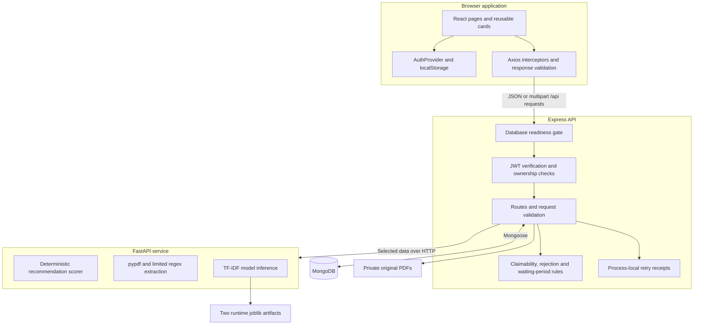
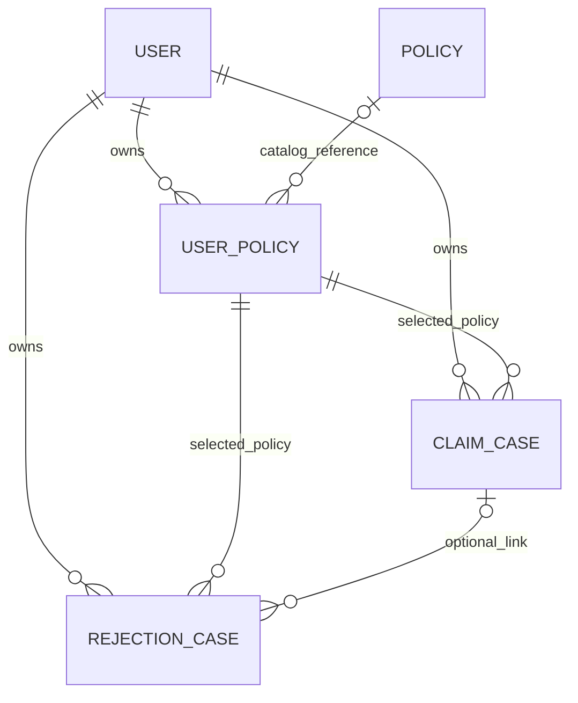

# InsureLens architecture

This document describes the inspected implementation as of 13 October 2026. Setup and execution commands are in [README.md](README.md); verification scope is in [DOCUMENTATION_AUDIT.md](DOCUMENTATION_AUDIT.md).

## Component architecture



[client/src/App.jsx](client/src/App.jsx) defines page routes. [AuthenticatedLayout.jsx](client/src/pages/AuthenticatedLayout.jsx) wraps protected pages with navigation and a main region. The UI uses React state/context, existing CSS and Axios, not a Redux store or component-library dependency.

[server/server.js](server/server.js) configures Express, Helmet, CORS, JSON parsing, an API-wide MongoDB readiness gate, authentication rate limiting and route mounts. Mongoose owns database access. [ml-service/main.py](ml-service/main.py) exposes three processing endpoints and a basic health response. The browser does not call FastAPI directly in the application workflows.

| Component | Local demo address / configuration |
| --- | --- |
| Vite | Port 5173 when started as documented; `/api` proxy target is hardcoded to `http://localhost:5000`. |
| Express | `PORT`, default 5000; loads `server/.env` when started from `server/`. |
| MongoDB | `MONGO_URI`; the example uses local port 27017 and database `insurelens`. |
| FastAPI | Port 8000 in the documented Uvicorn command; Express uses `ML_SERVICE_URL`. |
| Browser origin | `CLIENT_URL` is the Express CORS origin, default `http://localhost:5173`. |

Vite's development proxy is only a development facility. The current Express server neither serves `client/dist` nor provides production client-route fallback hosting.

## Data model and storage boundaries

The five Mongoose models are [User](server/models/User.js), [Policy](server/models/Policy.js), [UserPolicy](server/models/UserPolicy.js), [ClaimCase](server/models/ClaimCase.js) and [RejectionCase](server/models/RejectionCase.js).



- `User` holds account/profile information, the password hash, embedded family members and insurance requirement fields. Family members are subdocuments, not a separate collection.
- `Policy` holds catalog products: available coverage amounts, limited eligibility, waiting periods, hospitalization/room terms, co-pay/deductible, conditions, exclusions, sub-limits and external links. `basePremium` lacks quote-period/scope metadata.
- `UserPolicy` belongs to one user. `sourceType` distinguishes `Catalog` (a `Policy` reference) from `Uploaded` (extracted terms and document metadata). Sum insured, policy number and period are recorded on the saved policy. A partial unique index applies to nonempty policy numbers per user; unnumbered duplicates also rely on application checks.
- `ClaimCase` records hospitalization, patient/family reference, dates/times, diagnosis/treatment, bill, daily room rent and reported non-payable expenses.
- `RejectionCase` records rejection text, remarks, amount/date and an optional linked hospitalization. The link must belong to the same user and saved policy.

Analysis GET routes compute responses from saved records; they do not create another case or persist an analysis history. Original PDF bytes live under `server/uploads/policies/`, not in MongoDB. New records retain bounded rule-evidence snippets and structured extraction data; normal responses omit stored evidence and server file paths/names. This does not constitute encrypted storage or complete document anonymization.

## Endpoint inventory

Paths below are Express paths after their mount prefixes. The catalog API is public; its UI is inside the authenticated layout. All `/api` paths still pass through the database readiness gate.

| Express path | Methods | Access / purpose |
| --- | --- | --- |
| `/api/auth/register` | POST | Public registration; rate-limited. |
| `/api/auth/login` | POST | Public login; rate-limited. |
| `/api/auth/profile` | GET, PUT | JWT; retrieve/update current user's profile. |
| `/api/protected` | GET | JWT; simple protected-route response. |
| `/api/policies` | GET | Public catalog list. |
| `/api/policies/:id` | GET | Public catalog detail. |
| `/api/recommendations` | POST | JWT; authenticated requirements and active catalog scoring. |
| `/api/family-members` | GET, POST | JWT; list/add current user's embedded members. |
| `/api/family-members/:memberId` | PUT, DELETE | JWT; edit/delete owned embedded member. |
| `/api/user-policies` | GET, POST | JWT; list owned policies/save a catalog policy. |
| `/api/user-policies/upload` | POST | JWT; one multipart PDF and manual policy metadata. |
| `/api/claim-cases` | GET, POST | JWT; list/create owned hospitalizations. |
| `/api/claim-cases/:caseId/analyze` | GET | JWT; read-only rule assessment. |
| `/api/rejection-cases` | GET, POST | JWT; list/create owned rejection records. |
| `/api/rejection-cases/:caseId` | GET | JWT; retrieve owned rejection. |
| `/api/rejection-cases/:caseId/analyze` | GET | JWT; rule analysis plus optional ML prediction. |

| FastAPI path | Method | Responsibility |
| --- | --- | --- |
| `/health` | GET | Basic service status; does not load/check ML models. |
| `/recommend` | POST | Pydantic-validated requirements/catalog request; deterministic scoring and assessments. |
| `/extract-policy-text` | POST | Multipart `policyDocument`; bounded text-PDF processing. |
| `/predict-rejection` | POST | JSON `rejectionReason`, optional `insurerRemarks`; experimental classifiers. |

FastAPI also supplies its default `/docs` and `/openapi.json`. Its processing endpoints have no application/service authentication and should stay within the trusted local/internal network. An endpoint's presence does not imply a corresponding user-facing history, editing or deletion screen.

## Authentication flow

```mermaid
sequenceDiagram
    participant UI as React
    participant API as Express
    participant DB as MongoDB
    UI->>API: POST /api/auth/register or /api/auth/login
    API->>API: Validate and normalize input
    API->>DB: Create account with bcrypt hash or find account
    API->>API: Hash or compare password; sign one-hour JWT
    API-->>UI: User data and token
    UI->>UI: Store user and token in localStorage
    UI->>API: Protected request with Authorization Bearer token
    API->>API: Verify JWT; derive owner from decoded ID
    API->>DB: Query with authenticated ownership scope
    API-->>UI: Owned data or error
```

The implementation is in [auth.js](server/routes/auth.js), [auth middleware](server/middleware/auth.js) and [AuthContext.jsx](client/src/context/AuthContext.jsx). Passwords are bcrypt-hashed using a generated salt with cost 10; password hashes are omitted from normal auth/profile responses. JWTs carry the user ID and expire after one hour.

Axios reads the latest token before each request. The React layout checks local user state for navigation, while the server verifies JWTs and ownership. Logout clears localStorage/context and navigates to Login; it does not revoke a previously issued token server-side. There is no refresh-token flow. Authentication routes have a 100-request/15-minute rate limiter. The readiness gate can return 503 before authentication is evaluated when MongoDB is unavailable.

## Policy recommendation workflow

1. React collects coverage type/amount, optional annual budget, cost-sharing/room preferences and disease/lifestyle inputs. Family selection uses saved embedded member IDs.
2. `POST /api/recommendations` validates the request, loads the authenticated profile, derives ages from recorded birth dates and verifies selected member ownership. Client-provided demographic overrides do not replace the stored profile/member data.
3. Express builds insured-person metadata and merged disease inputs, selects active catalog products and validates their scoring terms. Names and database member identifiers are not forwarded in the additive `insuredMembers` list. Uploaded saved policies are not recommendation candidates.
4. Express sends `{ userRequirements, policies }` to FastAPI `/recommend` with a 10-second timeout.
5. FastAPI filters incompatible coverage type, recorded age exclusions and insufficient coverage tiers. It selects the smallest available coverage tier meeting the request, calculates a deterministic score, sorts descending and returns at most five candidates.
6. Independent assessments explain unknown annual pricing and incomplete family eligibility. Express validates response shapes and ensures returned IDs belong to its submitted catalog before forwarding results.
7. React renders score breakdowns, assessments and navigation/save actions. Saving a candidate is a separate authenticated `POST /api/user-policies`, not an insurer purchase.

Source: [recommendations.js](server/routes/recommendations.js), [main.py](ml-service/main.py), [recommendation_validation.py](ml-service/recommendation_validation.py), [recommendation_assessment.py](ml-service/recommendation_assessment.py).

The score includes coverage (30), co-payment (15), room rent (15), PED waiting when applicable (15), initial/specific waiting durations (10), and hospitalization benefits (15). It is normalized to 100 using 100 applicable points with PED, or 85 without PED. It is a preference match score, not learned ML or a probability of eligibility/approval.

For families, available entry-age bounds are checked per adult; documented failures remove a candidate. Children and missing relationship/dependency rules remain insufficient information. The catalog adapter never promotes unscoped `basePremium` into an annual quote, so budget affordability remains unverified. Budget, gender, city, income and lifestyle flags do not alter the current score; their presence in the request is not evidence of actuarial underwriting.

## Claimability workflow

```mermaid
sequenceDiagram
    participant UI as React
    participant API as Express rules
    participant DB as MongoDB
    UI->>API: POST /api/claim-cases with retry key
    API->>DB: Validate owned policy/patient and save hospitalization
    API-->>UI: Saved claimCase ID
    UI->>API: GET /api/claim-cases/:caseId/analyze
    API->>DB: Read owned case and saved policy/catalog terms
    API->>API: Validate stored data; compute waiting and rule checks
    API-->>UI: Score/estimates or unverified uploaded result; review reasons
```

[claimCases.js](server/routes/claimCases.js) validates patient selection, dates/times, text, bill/room amounts and expense totals before saving. Analysis uses owner-scoped reads and preserves raw legacy dates for strict calendar validation.

For catalog policies, checks cover recorded policy activity, initial waiting, hospitalization eligibility/minimum hours, room rent/type and sum insured. The numeric score uses 25/20/20/15/20 points respectively, with unknown room-rent checks omitted from the denominator. Financial outputs deduct reported non-payable expenses, estimated co-payment and deductible; room-related or other unverified conditions may require further review. This calculation is not an insurer settlement engine.

For uploaded policies, [uploadedPolicyReview.js](server/services/uploadedPolicyReview.js) returns `claimabilityScore: null`, null co-payment/deductible/payable estimates, and unverified coverage/room checks. Manually entered bill versus sum insured remains an arithmetic comparison, not proof of payable coverage. No FastAPI call occurs in either claimability path.

Both modules use [waitingPeriodAnalyzer.js](server/services/waitingPeriodAnalyzer.js): initial periods add UTC calendar days; PED/specific periods use clamped calendar-month anniversaries. Missing definitions stay unknown. Exact positive-duration boundary days require wording review. PED/specific timelines do not independently establish applicability; diagnosis matches are hints. The frontend formats provided dates and does not calculate waiting eligibility.

## Rejection analysis and recovery workflow

1. React submits rejection reason, optional insurer remarks/amount/date, owned saved policy and optional linked hospitalization to `POST /api/rejection-cases`. Waiting-period reasons require a linked case. Ownership and same-policy linkage are enforced.
2. React analyzes the saved ID through `GET /api/rejection-cases/:caseId/analyze`.
3. Express loads the rejection, policy and linked case. [rejectionAnalyzer.js](server/services/rejectionAnalyzer.js) matches text keywords, runs the shared waiting-period analysis, and generates possible categories, evidence status, policy clauses and recovery actions.
4. [rejectionMLService.js](server/services/rejectionMLService.js) separately posts rejection text/remarks to FastAPI `/predict-rejection`, with a five-second timeout. It does not send policy PDF bytes to the classifier.
5. Python lazily loads the runtime models and predicts a category with each pipeline. It returns class scores, agreement, review reasons and an experimental evaluation note.
6. Express validates the ML response and returns rule `analysis` and separate `mlPrediction`. Invalid/unavailable ML yields `available: false` while a valid rule result is retained.
7. React displays explanations/recovery steps and distinguishes ML availability. A retry after analysis failure reuses the known saved rejection case where the payload is unchanged.

Recovery guidance requests evidence or insurer reconsideration; it does not lodge an appeal, establish medical applicability or guarantee reversal. For uploaded policies, clause displays carry extraction review and unknown-term safeguards.

## PDF upload and extraction workflow

```mermaid
sequenceDiagram
    participant UI as My Policies
    participant API as Express
    participant Disk as Private disk
    participant PY as FastAPI
    participant DB as MongoDB
    UI->>API: POST /api/user-policies/upload multipart
    API->>API: JWT, upload limits, metadata, signature, duplicate checks
    API->>Disk: Store UUID-named PDF with private permissions
    API->>PY: POST /extract-policy-text with policyDocument
    PY->>PY: Strict pypdf parsing and supported regex extraction
    PY-->>API: Counts, bounded evidence, extractedPolicyData or safe error
    API->>API: Validate extraction response; preserve unknowns
    API->>DB: Save owned Uploaded UserPolicy and manual metadata
    API-->>UI: Sanitized saved policy and extractionReview
    UI->>UI: Review acknowledgment remains local state
```

Source: [policyUpload.js](server/middleware/policyUpload.js), [userPolicies.js](server/routes/userPolicies.js), [pdfValidation.js](server/utils/pdfValidation.js), [pdf_processing.py](ml-service/pdf_processing.py), [PolicyExtractionReview.jsx](client/src/components/PolicyExtractionReview.jsx).

The multipart file field is `policyDocument`; the UI supplies `policyNumber`, `selectedCoverage`, `policyStartDate` and `policyEndDate`. These are manually entered, not inferred as certified PDF facts. Multer accepts one file with a 10 MB limit and bounded fields/parts. New originals have generated UUID filenames and mode `0600`; newly created directories use `0700` on Linux. Existing files are not retroactively modified.

FastAPI checks PDF MIME/signature, strict readability, encryption and limits: 1–50 pages, 200,000 extracted characters, at least 100 characters overall, and readable nonempty text on every page. Scanned/mixed-image documents and OCR are rejected. Parsing uses a worker thread with a 20-second response timeout; Express permits 30 seconds upstream and the browser upload 40 seconds. A timeout cannot forcibly terminate a running parsing thread.

Supported English patterns extract candidate durations and selected restrictions; missing/conflicting unsupported values remain null. Complete exclusions/sub-limits and applicability require review. At most 12,000 characters of truncated rule-evidence lines are retained for source checks rather than full raw text for new uploads. Original documents and snippets can still contain sensitive data.

Responses remove stored evidence and server paths/names, expose unverified extracted-term summaries and retain manual-review warnings. The acknowledgment checkbox does not persist verification or enable estimates. Known failed uploads remove their own temporary file; an uncertain database commit retains the file for reconciliation rather than risking deletion of an already-saved document. There is no original-document download/delete/correction endpoint in this router.

## Rules versus ML

| Responsibility | Implementation | Interpretation |
| --- | --- | --- |
| Recommendation ranking | Explicit Python scoring rules and eligibility assessments | Transparent preference matching, not predictive ML. |
| Policy text extraction | pypdf plus limited regex patterns | Candidate terms, not general document understanding or certified coverage. |
| Waiting-period timelines | Shared Express calendar rules | Nominal dates/statuses; applicability/boundary wording may remain unknown. |
| Claimability | Express policy/date/amount checks | Preliminary catalog estimate; conservative unknowns for uploads. |
| Rejection explanations/recovery | Express keyword rules and evidence checks | Possible categories and review actions. |
| Rejection text classification | TF-IDF plus Logistic Regression V2 and Decision Tree | Experimental synthetic-data classification requiring human review. |

[rejection_predictor.py](ml-service/rejection_predictor.py) loads `ml-service/models/rejection_logistic_v2.joblib` and `ml-service/models/rejection_classifier.joblib`. Other checked-in models and training/evaluation scripts are experiment artifacts, not automatically selected at runtime. The separate tree V2 file is not the runtime tree. Scores are uncalibrated and are not probabilities of correctness, coverage, approval or recovery. The predictor always requests human review. There is no LLM, RAG service or automated insurer integration in the inspected application.

## Error handling and service failure

| Condition | Current behavior |
| --- | --- |
| Required Express variable missing | Startup exits with the variable name; no secret value is printed. |
| MongoDB disconnected/connecting | API readiness gate returns 503 with `Retry-After: 5`; initial connection failures schedule five-second retries. Mongoose buffering is disabled and connection/socket/query waits are bounded. |
| Invalid input/token/ownership | JSON error responses; generally 400 invalid input, 401 missing/invalid JWT, and 404 absent/foreign scoped resources. |
| Recommendation FastAPI failure | No fabricated recommendation fallback: malformed upstream results 502, service unavailability 503, timeout 504; valid empty results are distinct. |
| Rejection ML failure | Rule results remain available with explicit `mlPrediction.available: false`; no invented score/prediction. |
| FastAPI unavailable during claimability | No dependency on it; Express rules can run if MongoDB and saved data are available. |
| PDF rejection or extraction failure | Invalid/protected/unreadable document errors; timeout 504; unavailable extraction 503; malformed extraction response 502. No confirmed policy-save success is shown. |
| Malformed browser response | Shared list/detail/create and recommendation/analysis guards reject unsupported shapes before rendering. |
| Browser transport failure | Axios default timeout 20 seconds (upload 40); actionable error, released loading guard, same-page form values retained. |
| Uncertain database save | Explicit 503 save-status-unknown message instructs the user to inspect saved records. |

[httpClient.js](client/src/utils/httpClient.js) installs the shared timeout/error normalization; [serviceResilience.js](client/src/utils/serviceResilience.js) validates response envelopes and generates retry headers. There are no automatic browser write retries, offline cache or persisted drafts.

Creation routes for catalog policies, uploads, claims and rejections use [idempotency.js](server/middleware/idempotency.js). A UUID-shaped `Idempotency-Key`, authenticated owner, route and payload fingerprint identify a receipt. Concurrent retries can reuse successful responses; changed payloads with a reused key return 409. Receipts expire after ten minutes and are capped at 1,000 per middleware instance. They are in-memory, not durable distributed transactions: restarts, another replica, expired receipts or lost browser keys can defeat that protection. Unknown commit status requires reconciliation.

## Demonstration and deployment boundaries

[README.md](README.md) lists automated versus live audit commands. [SERVICE_RESILIENCE_AUDIT.md](SERVICE_RESILIENCE_AUDIT.md), [PDF_HARDENING_REPORT.md](PDF_HARDENING_REPORT.md) and [FINAL_UI_AUDIT.md](FINAL_UI_AUDIT.md) record prior scoped results; they are not universal production certifications.

Production authentication/session design, internal-service authentication, TLS, document encryption/retention, malware/resource isolation, distributed write reconciliation, representative ML validation, load testing and full accessibility/cross-browser verification remain gaps. InsureLens is an academic prototype: original policy wording and insurer decisions govern coverage, and all uncertainty or ML results require independent review.
