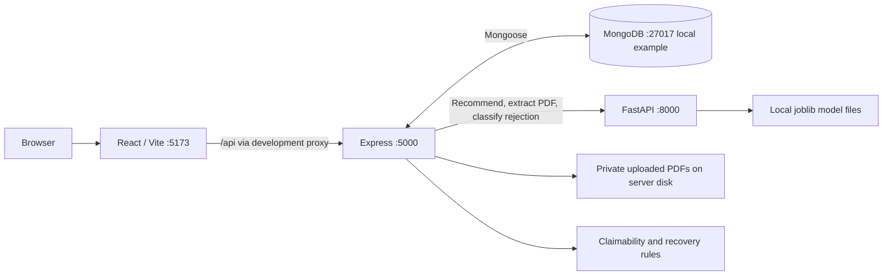

# InsureLens

**A MERN + FastAPI health insurance decision-support prototype for an MCA final project.**

InsureLens helps users compare catalog policies, organize their existing coverage, assess a recorded hospitalization against selected policy terms, and understand possible claim-rejection reasons and recovery steps. It combines transparent rules with experimental text classification, while making unknown policy information and the need for human review explicit.

## Problem statement

Health insurance documents contain waiting periods, room restrictions, co-payments, deductibles and exclusions that are difficult to compare or interpret. A hospitalization or rejection letter adds another layer of uncertainty. InsureLens brings these details into a single interface and explains the checks it can perform. It does not replace the original contract, insurer underwriting, medical evidence or professional advice.

## Features and modules

| Module | Implemented behavior |
| --- | --- |
| Login and Registration | Account validation, bcrypt password hashing and JWT authentication. |
| Dashboard | Welcome page and navigation to the application modules. |
| Profile | View and edit personal, contact and financial profile fields. |
| Policy Catalog and Details | Search/filter catalog policies; view coverage, eligibility, waiting periods, room restrictions, exclusions and document links when recorded. |
| Recommendations | Individual/Family Floater candidates, deterministic match scores, score breakdowns, premium uncertainty and per-member family eligibility assessments; save a recommended catalog policy. |
| Family members | Add, edit, delete and select embedded family profiles through Recommendations. |
| My Policies | List saved catalog/uploaded policies; upload a supported policy PDF with manually entered coverage, number and dates; review extracted terms. |
| Claimability Analysis | Save hospitalization details and reported non-payable expenses; perform rule checks, waiting-period analysis and preliminary financial estimates for catalog policies. Uploaded coverage remains unverified with unknown score/payment estimates. |
| Rejection Analysis & Recovery | Save rejection details, optionally link a hospitalization, display rule-derived explanations/recovery guidance and experimental Logistic Regression/Decision Tree classifications. Waiting-period rejection verification requires a linked hospitalization. |

Recommendations use active catalog products, not uploaded policies. Insurer links open external websites; the application does not sell policies or submit claims/appeals.

## Technology stack

| Layer | Dependencies / implementation |
| --- | --- |
| Frontend | React 19, React Router 7, Axios, Vite 8, CSS; ESLint 10. |
| API | Node.js, Express 5, Mongoose 9, bcrypt, JSON Web Token, Multer, Axios, dotenv, cors, Helmet, express-rate-limit; nodemon for development. |
| Persistence | MongoDB for account, catalog, saved-policy and case records; private server disk storage for uploaded originals. |
| Python service | FastAPI, Uvicorn, Pydantic 2, pypdf; NumPy, pandas, scikit-learn and joblib for model tooling/inference. |
| ML | TF-IDF text pipelines with Logistic Regression V2 and a Decision Tree classifier. |
| Tests | Node's built-in test runner, Python unittest and Chrome DevTools Protocol browser scripts. |

Exact JavaScript ranges and Python pins are in [client/package.json](client/package.json), [server/package.json](server/package.json) and [ml-service/requirements.txt](ml-service/requirements.txt). `pdf2image`, `pytesseract` and Pillow remain declared dependencies, but the current upload endpoint does **not** provide OCR.

## Architecture overview



React sends relative `/api` requests to Express through Vite's development proxy. Express owns authentication, ownership checks and persistence. FastAPI handles deterministic recommendation scoring, constrained PDF text extraction and experimental rejection classification. Claimability runs in Express and does not call FastAPI. See [ARCHITECTURE.md](ARCHITECTURE.md) for workflows, endpoint tables and failure behavior.

## Prerequisites

- Ubuntu/Linux, or Ubuntu inside WSL 2 on Windows. Ubuntu 24.04 LTS is a practical installation target; fresh installation on it was not executed in this documentation audit.
- Node.js **24.x** with npm. This satisfies the installed Vite/ESLint/Mongoose engine requirements and supports the native WebSocket browser harness. The inspected environment used Node 24.20.0 and npm 11.19.0. Install through the [official Node.js download instructions](https://nodejs.org/en/download).
- Python **3.12 or newer** with pip and venv support. The NumPy/SciPy dependency metadata requires at least 3.12; the existing project environment inspected here used Python 3.14.4. Fresh installation on each supported Python/platform combination has not been verified.
- A reachable MongoDB server. For Ubuntu, follow the [official MongoDB Community installation guide](https://www.mongodb.com/docs/v8.0/tutorial/install-mongodb-on-ubuntu/) for your release; the startup commands below assume the official `mongod` systemd service. `mongosh` is useful for the local ping check.
- Git; `curl` for optional service checks. Build tools may be needed where dependency wheels/prebuilt binaries are unavailable.
- Optional: Google Chrome for browser audits. No GPU or external LLM API is needed.

## Installation: Ubuntu/Linux

### 1. Obtain the project and install dependencies

Replace `YOUR_REPOSITORY_URL` with this project's GitHub clone URL. If already in a checkout, skip the clone step. Subsequent commands are Bash commands; run them from the stated directories.

```bash
git clone YOUR_REPOSITORY_URL insurelens
cd insurelens
```

Install Python tooling and basic build utilities on Ubuntu, then install Node.js and MongoDB using the official guides above if absent:

```bash
sudo apt-get update
sudo apt-get install -y git curl python3 python3-venv python3-pip build-essential
node --version
npm --version
python3 --version
```

Confirm the Python interpreter is at least 3.12 before continuing. If your distribution provides an older interpreter, install a suitable interpreter and use it in place of `python3` when creating the venv.

From the repository root:

```bash
(cd server && npm ci)
(cd client && npm ci)
python3 -m venv ml-service/venv
ml-service/venv/bin/python -m pip install -r ml-service/requirements.txt
```

The repository has separate frontend/backend lockfiles and no root `package.json` or all-services start script. `npm ci` belongs in `client/` and `server/`. Keep the venv name `venv` if using the optional live PDF audit, which references that path. Do not overwrite an existing environment just to follow these instructions.

### 2. Configure the backend environment

Copy the template **only if `server/.env` does not already exist**:

```bash
cp server/.env.example server/.env
```

Edit the new local file. This example contains only local-development addresses and a secret placeholder:

```dotenv
PORT=5000
MONGO_URI=mongodb://127.0.0.1:27017/insurelens
JWT_SECRET=REPLACE_WITH_A_PRIVATE_RANDOM_SECRET
ML_SERVICE_URL=http://127.0.0.1:8000
CLIENT_URL=http://localhost:5173
```

| Variable | Requirement / use |
| --- | --- |
| `MONGO_URI` | Required, nonempty MongoDB connection URI. The example is a local development database without credentials. |
| `JWT_SECRET` | Required, nonempty signing secret. Replace the placeholder with your own strong random value; never commit it. |
| `ML_SERVICE_URL` | Required, nonempty FastAPI base URL, without an endpoint suffix. |
| `PORT` | Optional Express port; defaults to `5000`. |
| `CLIENT_URL` | Optional allowed frontend origin; defaults to `http://localhost:5173`. |

Express loads `.env` relative to its working directory, so start it from `server/`. There are no application `VITE_*` variables or Python `.env` requirements in the inspected runtime. Changing Express's port also requires adjusting the hardcoded target in [client/vite.config.js](client/vite.config.js). Keep ports 5000/8000/5173 for the provided live audits.

`.env` and `venv/` are ignored by the existing root `.gitignore`. Never add tokens, database passwords, private PDFs or personal user data to GitHub or screenshots. Uploaded files under `server/uploads/policies/` are runtime private data and must be excluded from publication; the current root ignore file does not explicitly ignore that upload directory.

### 3. Start MongoDB

For an installed systemd-managed MongoDB Community service:

```bash
sudo systemctl start mongod
sudo systemctl status mongod --no-pager
mongosh 'mongodb://127.0.0.1:27017/insurelens' --quiet --eval 'db.runCommand({ ping: 1 })'
```

If MongoDB runs on another host or through another installation method, start it using that method and configure `MONGO_URI` accordingly. The above service name is not a repository-provided service. Express may start before MongoDB connects, but API requests return 503 until the connection is ready.

### 4. Initialize the catalog, only for a new disposable demo database

[server/scripts/seedPolicies.js](server/scripts/seedPolicies.js) loads [server/data/policies.json](server/data/policies.json). **It first deletes every existing catalog `Policy` document.** Run it only when intentionally initializing an empty/disposable database. Reseeding a database containing saved policies can invalidate their catalog references. It is not a routine startup command.

From the repository root, for that explicit initialization only:

```bash
(cd server && node scripts/seedPolicies.js)
```

Without catalog initialization, catalog browsing can be empty and catalog recommendations cannot produce candidates. Do not reseed an existing demonstration database to troubleshoot another service.

### 5. Start the application

Open separate terminals, each beginning at the repository root.

**FastAPI:**

```bash
cd ml-service
venv/bin/python -m uvicorn main:app --host 127.0.0.1 --port 8000 --reload
```

**Express:**

```bash
cd server
npm run dev
```

`npm start` runs the same API without nodemon. Keep FastAPI local: the Python endpoints do not implement service authentication.

**React:**

```bash
cd client
npm run dev -- --host 127.0.0.1 --port 5173 --strictPort
```

Open `http://localhost:5173`. Use the same origin consistently; localStorage login state is origin-specific. MongoDB, Express, FastAPI and Vite must all be available for the complete demonstration. Stop the development processes with `Ctrl+C` when finished.

Optional read-only startup checks, from another terminal:

```bash
curl --fail http://127.0.0.1:8000/health
curl --fail http://localhost:5000/api/policies
```

FastAPI's interactive documentation is at `http://127.0.0.1:8000/docs`. `/health` checks the Python service response, not model readiness; rejection models are loaded lazily on prediction. Express does not define `/health`.

## Windows with WSL 2

Run the installation command in **administrator PowerShell**, following [Microsoft's WSL installation guide](https://learn.microsoft.com/en-us/windows/wsl/install):

```powershell
wsl --install -d Ubuntu-24.04
wsl --list --verbose
```

Restart if prompted and complete Ubuntu's initial user setup. Run all project installation, npm, Python and server commands **inside Ubuntu/WSL**, using the Linux instructions above. Keep the checkout and venv in the Linux home filesystem; do not reuse Windows `node_modules` or a Windows Python environment.

MongoDB's `systemctl` instructions require systemd. If it is disabled, follow [Microsoft's systemd setup guide](https://learn.microsoft.com/en-us/windows/wsl/systemd/) and restart WSL before using the service. Open the app from the Windows browser at `http://localhost:5173`; environment-specific networking/firewall issues may require troubleshooting. Native Windows installation and WSL browser automation were not tested here.

## Automated checks

Run these from the repository root:

```bash
node --test --test-isolation=none server/tests/*.test.js
PYTHONDONTWRITEBYTECODE=1 ml-service/venv/bin/python -m unittest discover -s ml-service -p 'test_*.py' -v
(cd client && npm run lint)
(cd client && npm run build)
```

The Node suite includes frontend validation imports, route/service/middleware tests and synthetic filesystem fixtures; database/upstream operations are mocked in this suite. Python tests cover request validation, scoring/assessments and generated PDF fixtures. `server`'s `npm test` is currently a failing placeholder; there is no frontend `npm test` script. Use the commands above rather than claiming either script runs the suites.

### Optional browser audit without backend writes

Run Vite at port 5173, then start a separate, isolated Chrome profile:

```bash
google-chrome --headless --disable-gpu --remote-debugging-address=127.0.0.1 --remote-debugging-port=9229 --user-data-dir=/tmp/insurelens-ui-audit-profile about:blank
```

In another terminal at the repository root:

```bash
node client/scripts/uiAudit.mjs
```

The harness supplies a synthetic browser identity and intercepts all `/api/*` requests. It checks ten routes at four widths, expanded forms, result displays, keyboard focus and error/empty states. It writes results to `/tmp/insurelens-ui-results.json` and a screenshot to `/tmp/insurelens-ui-mobile.png`. Close the isolated Chrome process afterward. This browser audit does not establish live API correctness. Chrome availability/launch flags can differ by environment; use a local non-root browser process with its sandbox enabled where supported.

### Optional live integration audits

With all services running and `server/.env` configured:

```bash
node server/scripts/liveIntegrationAudit.js
node server/scripts/liveIntegrationAudit.js --regression
node server/scripts/liveIntegrationAudit.js --pdf
node server/scripts/liveIntegrationAudit.js --resilience
```

Run one mode at a time. These scripts launch `google-chrome`, create synthetic accounts/cases (and PDF fixtures in PDF mode), exercise actual services and attempt owner-verified cleanup. Use a disposable local test database. They are **not read-only**, were not executed for this documentation task, and require local socket/browser permissions. Their default reports are `/tmp/insurelens-integration-results.json`, `/tmp/insurelens-regression-results.json`, `/tmp/insurelens-pdf-hardening-results.json` and `/tmp/insurelens-service-resilience-results.json`; `INTEGRATION_RESULT_PATH` overrides the output path. Inspect cleanup results after a failure. Training scripts are separate experiments, not tests or startup prerequisites.

## Project folder structure

```text
insurelens/
├── README.md
├── ARCHITECTURE.md
├── DOCUMENTATION_AUDIT.md
├── client/
│   ├── package.json, package-lock.json, vite.config.js, eslint.config.js
│   ├── public/                       # Static assets
│   ├── scripts/uiAudit.mjs            # Synthetic Chrome UI audit
│   └── src/
│       ├── pages/                    # Authentication and application pages/CSS
│       ├── components/               # Policy/recommendation cards, extraction review
│       ├── context/, hooks/          # Authentication state
│       ├── utils/                    # Validation, HTTP handling, date display
│       └── App.jsx, main.jsx
├── server/
│   ├── server.js, package.json, package-lock.json
│   ├── .env.example                  # Public placeholder configuration
│   ├── models/                       # User, Policy, UserPolicy, ClaimCase, RejectionCase
│   ├── routes/, middleware/          # REST API, auth, uploads, retry receipts
│   ├── services/, utils/             # Rule analysis and validation
│   ├── data/policies.json            # Catalog seed definitions
│   ├── scripts/, tests/              # Seed/live audit scripts and Node tests
│   └── uploads/policies/             # Private runtime PDFs; created on upload
├── ml-service/
│   ├── main.py, requirements.txt
│   ├── recommendation_validation.py, recommendation_assessment.py
│   ├── rejection_predictor.py
│   ├── pdf_processing.py, pdf_test_fixture.py
│   ├── models/                       # Checked-in experimental joblib artifacts
│   ├── datasets/                     # Synthetic rejection datasets
│   ├── test_*.py                     # Python unittest suites
│   └── train_*.py, evaluate_rejection_models.py, other experiment scripts
└── *_AUDIT.md / *_RESULTS.json        # Historical validation/integration evidence
```

There is no Docker Compose setup, deployment pipeline or root npm workspace in the inspected repository. `ml-service/READNME.md` is an empty legacy file; this README provides the service setup.

## Suggested MCA demonstration sequence

1. Use a fictional account to demonstrate registration/login and Profile.
2. Browse a catalog policy and explain its recorded terms and disclaimers.
3. Request individual/family recommendations; explain score breakdowns, unknown annual premiums and incomplete family eligibility.
4. Save a catalog policy and record a fictional hospitalization. Show claimability checks, nominal waiting timelines and review requirements.
5. Enter a fictional rejection; link the hospitalization when waiting-period verification is needed. Explain rule guidance and the separate experimental ML result.
6. Optionally upload a short synthetic, unencrypted text PDF. Show extracted versus unknown terms and the conservative uploaded-policy result.

## Known limitations

- An unscoped catalog `basePremium` is not a verified annual quote. Current budget assessments cannot certify affordability or filter by trusted annual prices; sum insured is never premium.
- Family matching checks available adult entry-age bounds for each member. Child, relationship and dependency eligibility remain unverified without insurer rules. Lifestyle, gender, city and income fields do not contribute to the current recommendation score.
- Waiting periods are nominal timelines based on recorded commencement/admission and durations. Positive-duration boundary days, PED/specific-illness applicability, continuity, exceptions and endorsements require review.
- Catalog claimability scores and financial estimates are preliminary rule outputs, not payable entitlements. Uploaded policies return null score and deduction/payment estimates until terms can be independently verified.
- PDF parsing supports limited English patterns and only unencrypted text PDFs: maximum 10 MB, 1–50 pages, at most 200,000 extracted characters, no unreadable/textless pages, and at least 100 characters overall. Scanned/mixed-image PDFs and OCR are unsupported. Timing out a response does not forcibly terminate the parser worker.
- ML classification is trained on synthetic data. Class scores are uncalibrated; every prediction requires human verification. The runtime loads `rejection_logistic_v2.joblib` and `rejection_classifier.joblib`, not the separate `rejection_tree_v2.joblib` artifact. No real-world accuracy claim is made.
- JWTs last one hour and are stored in localStorage; there is no refresh-token or server-side logout revocation workflow. Retry receipts are process-local, expire after ten minutes and do not ensure exactly-once writes across restarts/replicas.
- Extracted-term acknowledgment is local UI state, not persisted certification. There is no uploaded-policy correction/delete/download workflow in the existing user-policy router.
- Production hosting needs API proxy/static routing configuration: Vite's development proxy is not a production deployment. `npm run build` creates `client/dist`; Express does not serve that directory. TLS, service authentication, encrypted storage, retention, load testing and full security/accessibility certification are outside the demonstrated implementation.

See [FINAL_UI_AUDIT.md](FINAL_UI_AUDIT.md), [SERVICE_RESILIENCE_AUDIT.md](SERVICE_RESILIENCE_AUDIT.md), [PDF_HARDENING_REPORT.md](PDF_HARDENING_REPORT.md), [REGRESSION_AUDIT.md](REGRESSION_AUDIT.md), [WAITING_PERIOD_AUDIT.md](WAITING_PERIOD_AUDIT.md) and [RECOMMENDATION_CHANGES.md](RECOMMENDATION_CHANGES.md). Reports describe their own historical scope; older findings may be superseded by later source changes. [DOCUMENTATION_AUDIT.md](DOCUMENTATION_AUDIT.md) distinguishes checks performed for this documentation task from earlier test evidence.

## Screenshots

No curated, sanitized screenshots are committed with this documentation. These are placeholders, not broken image links:

| Screen | Screenshot placeholder |
| --- | --- |
| Login and Registration | Add a sanitized screenshot of both forms. |
| Dashboard and Profile | Add screenshots using fictional profile details. |
| Catalog and Policy Details | Add catalog/detail screenshots without private documents. |
| Recommendations | Add score breakdown and unknown-premium/eligibility displays. |
| My Policies | Add a synthetic uploaded policy and extracted-term review. |
| Claimability Analysis | Add a fictional case result with review disclaimer. |
| Rejection Analysis & Recovery | Add rule guidance and the experimental ML warning. |

Do not publish real names, contact details, policy/claim numbers, rejection letters, browser-storage tokens or private insurance documents.

## Academic prototype disclaimer

InsureLens is an academic decision-support prototype. It does not provide a binding insurance recommendation, underwriting decision, medical/legal advice, verified premium quote, claim approval or guaranteed appeal outcome. Original policy wording, endorsements, disclosures and insurer decisions govern coverage. Unknown/extracted fields and ML predictions require independent human verification; absence of a detected exclusion does not establish coverage.
